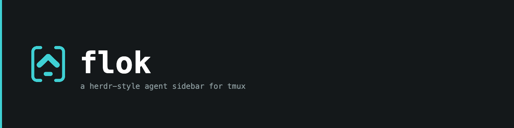
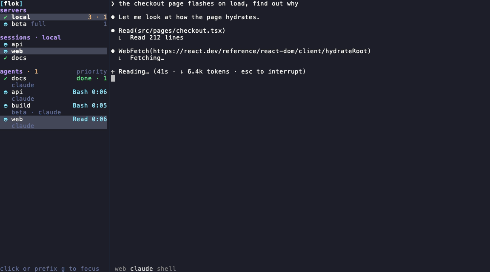
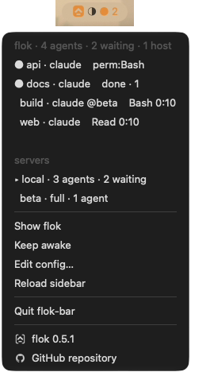
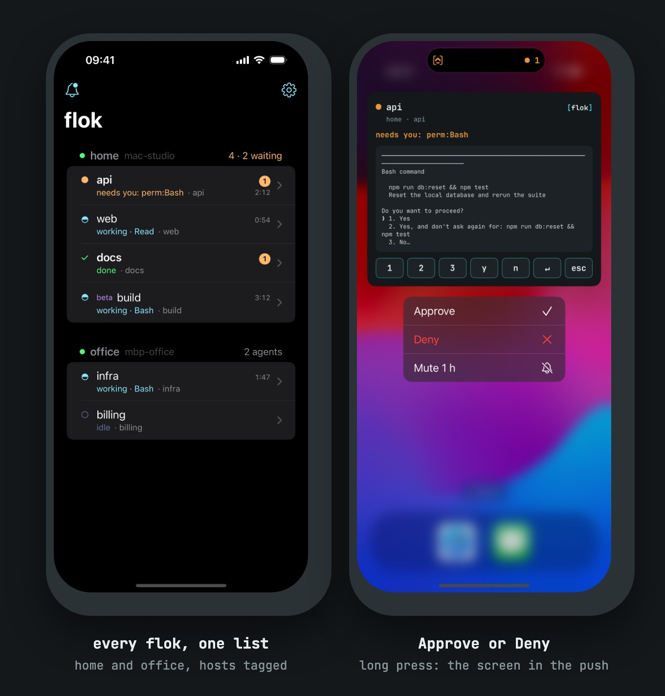

<p align="center"></p>

[](https://github.com/w4jnl/flok/actions/workflows/ci.yml)

See every Claude Code and Copilot CLI session in your tmux, on this machine and on the servers
you ssh into, which one is waiting on you, and jump there. Your tmux servers, configs and plugins
stay untouched.

flok is a narrow sidebar pane next to your normal tmux: the servers when there is more than one,
the sessions, the agents below with their state, a sound when an agent needs you, tmux menus of
all three, and a `prefix ?` popup with your live keybinds. Agents can run wherever the work is:
a host runs the same flok over your ssh config, and its agents arrive in the one sidebar, its
tmux a key press away. A menu bar item on the Mac and an app on the iPhone show the same states
while the terminal is out of sight. The sidebar is modelled on [herdr](https://herdr.dev)'s.

<p align="center"></p>

<p align="center"></p>

<p align="center">&nbsp;&nbsp;&nbsp;&nbsp;</p>

**On the Mac**, the menu bar companion (opt-in, `[bar] enabled = true`): a badge for the agents
waiting on you, a spinner while any works, the agents in a dropdown; a click brings the terminal
to the front on that pane. **On the iPhone**, the app, through a relay you run: every flok in one
list, an agent's live screen with keys to answer, a reply typed or dictated (hold the
microphone), a screenshot or a photo sent to the agent, a push with Approve, Deny and Reply when
one needs you (a long press shows its screen), and a Live Activity while agents work.

## Setup

Current version: 0.7.1 · [release notes](CHANGELOG.md). Needs tmux 2.7 or newer (everything
from 3.3) and Claude Code or Copilot CLI; details under [Requirements](#requirements).

1. Install the binary. Homebrew, on macOS or Linux:
   ```sh
   brew install w4jnl/tap/flok
   ```
   Or a prebuilt static binary from the [releases page](https://github.com/w4jnl/flok/releases)
   (Linux and macOS, `amd64` and `arm64`, no Go, no root):
   ```sh
   ver=0.7.1; os=$(uname -s | tr A-Z a-z); arch=$(uname -m | sed 's/x86_64/amd64/; s/aarch64/arm64/')
   curl -fsSLO "https://github.com/w4jnl/flok/releases/download/v$ver/flok_${ver}_${os}_${arch}.tar.gz"
   curl -fsSLO "https://github.com/w4jnl/flok/releases/download/v$ver/sha256sums.txt"
   shasum -a 256 -c --ignore-missing sha256sums.txt
   mkdir -p ~/.local/bin && tar -xzf "flok_${ver}_${os}_${arch}.tar.gz" --strip-components=1 -C ~/.local/bin "flok_${ver}_${os}_${arch}/flok"
   ```
2. Wire it up. This writes a commented `config.toml` with the defaults, installs the Claude Code
   hooks in `~/.claude/settings.json` and writes the Copilot CLI hooks when `~/.copilot` exists:
   ```sh
   flok install
   ```
   Your tmux.conf stays as it is: the sidebar binds flok's keys in your tmux server when it
   starts and removes them when it ends (see [Keys](#keys); `flok install --tmux` prints a
   snippet for those who want them in tmux.conf). No tmux configuration at all? `flok install`
   offers to write a starter one: prefix `C-a`, mouse, vi keys, splits that keep the directory,
   and tpm with sensible, yank, resurrect, continuum and the Dracula status line, installed at
   the first tmux start. Every line is annotated;
   [read it first](internal/install/tmux.conf.tmpl). `flok install --tmux-conf` writes it
   without asking, never over a file that exists.
3. Restart the Claude Code and Copilot sessions that are already running. Hooks load at start.
4. Start flok from a plain terminal, not from inside tmux:
   ```sh
   flok up
   ```

`flok doctor` checks every step: tmux version, hooks and the binary they call, sounds,
manifests, the keys flok has in your tmux, the running outer session, every remote host.

### More install options

- From source (Go 1.27): `git clone https://github.com/w4jnl/flok.git && cd flok && make install`
  builds `bin/flok` and copies it to `~/.local/bin`.
- One part at a time: `flok install --claude`, `--copilot`, `--config` or `--tmux-conf` do only
  that step; `--tmux` prints the optional tmux.conf snippet, `--tmux-resurrect` the opt-in snippet
  for tmux-resurrect.
- Shell completion (commands, flags, pane ids for `explain`, client ttys for `--client`):
  ```sh
  echo 'eval "$(flok completion bash)"' >> ~/.bashrc
  echo 'eval "$(flok completion zsh)"'  >> ~/.zshrc     # after compinit; or: flok completion zsh > ~/.zfunc/_flok
  ```
- From a window manager or a terminal binding: `flok up` exits 0 after a detach or `flok down`,
  so `flok up || tmux attach || tmux new-session` falls back to plain tmux only when flok cannot
  start. `flok up` starts the inner tmux server itself when needed.
- Resume the same Claude Code and Copilot conversations after a tmux-resurrect restore:
  [tmux-resurrect](docs/tmux-resurrect.md).
- Agents on other machines: [Remote hosts](docs/remote-hosts.md). The phone: [Setting it
  up](docs/phone.md#setting-it-up).

## Why flok

Several agents run at once, each in its own tmux session or window, on this machine and on
others behind ssh, and each shows only its own state. There is no glance-level overview: to
learn which one finished you cycle through sessions, and the agent that has been waiting for a
permission answer for an hour is the one you forgot.

flok frames your own tmux server with a sidebar, through a nested outer tmux server: your
server, its config, plugins and layouts are never modified, and a detach returns you to plain
tmux. Why not herdr: herdr is its own application that hosts the terminals; flok wraps the tmux
you already have, and reuses herdr's detection manifests and sounds under Apache-2.0 (see
[Credits](#credits-and-license)).

## Features

- **Every agent in one panel**, in a stable order (`1`-`9` always mean the same agent), with
  its state and what it does: working with the tool and the time (`Bash 0:42`), blocked
  (`perm:Bash`, `question`), paused while background work runs, done with an unread count,
  idle. The agents' own hooks are the source of truth; Claude's session registry, pane titles
  and herdr's screen rules fill in. The sessions above, each with its git branch.
  [How it works](docs/how-it-works.md)
- **Agents across servers**: the machines you ssh into join the same panels, tagged with their
  host; their tmux comes next to the sidebar with one key, and flok's keys work inside it. A host
  runs `flok serve` over ssh (`flok host install` puts it there), or is read through its tmux
  alone. [Remote hosts](docs/remote-hosts.md)
- **Straight to the one that needs you**: `prefix o` jumps there, `Enter` or a click opens any
  row, and tmux menus list the agents, sessions and servers (`prefix A`, `S`, `@`).
- **Sounds** for an agent that blocks or finishes in a pane you are not looking at, debounced.
- **Rail and hide**: the sidebar at six columns or none, one keystroke away.
- **Keybinds help**: `prefix ?` lists every live binding of your tmux server, grouped, with `/`
  to filter.
- **The menu bar** (macOS, opt-in) and **keep awake**: the Mac and its display stay on while
  agents run unattended, and Teams or Slack keep showing you active if you like.
  [Menu bar and keep awake](docs/macos.md)
- **flok on your phone**: the iOS app and `flok-relay`, a small service you host. Every flok
  dials out to it: no port opened anywhere, `HTTPS_PROXY` honoured, TLS inside the link for a
  proxy that reads HTTPS; `prefix U` switches it off. A plain message through ntfy works too.
  [flok on your phone](docs/phone.md)
- **Zero footprint**: no plugin, no pane injected into your windows, no change to tmux.conf;
  the keys flok binds for the session are removed when it ends.
- **tmux-resurrect** (opt-in): a restore resumes the same conversations.
  [tmux-resurrect](docs/tmux-resurrect.md)

## Keys

In tmux (your prefix):

| key | action |
|---|---|
| `prefix b` | toggle the sidebar between full width and the rail |
| `prefix B` | hide / show the sidebar (zooms the work pane) |
| `prefix g` | move the keyboard into the sidebar, or back to the work pane |
| `prefix o` | jump to the newest agent needing input, else the newest finished one |
| `prefix a` | next agent pane, in sidebar order |
| `prefix A` | a tmux menu of the agents over the work pane: `1`-`9` open one, remote ones tagged `@host` (tmux 3.0+) |
| `prefix S` | the same for the sessions of the server in front, the current one marked |
| `prefix @` | the same for the servers (as in `@beta`): local and the hosts with their state |
| `prefix u` | keep the Mac awake, display on, while flok runs; toggles, the state shows on the status line (macOS) |
| `prefix U` | switch the relay link (`[link] url`) off and on again; the state shows on the status line and in the sidebar |
| `prefix ?` | keybinds help popup (`?` inside the sidebar opens the same) |
| `prefix N` / `prefix P` | next / previous server to the front (local, then the hosts in order, wrapping) |
| `prefix O` | the previous server again (back and forth) |
| `prefix F1` … `F9` | server N to the front: F1 is local, F2 the first host |

The sidebar binds these in your tmux server when it starts and removes them when it ends;
nothing goes into tmux.conf. Which keys it may take over, the keys inside the sidebar, and going
back across servers: [Keys](docs/keys.md).

## Requirements

- tmux 2.7 or newer, macOS or Linux. Everything works from 3.3; older servers lose a little
  ([tmux versions](docs/how-it-works.md#tmux-versions)). `flok doctor` prints the version it found and what that version lacks.
- Claude Code and/or GitHub Copilot CLI for hook-driven state. Other agents get title and
  screen-rule detection only (manifests exist for Codex, Gemini and OpenCode).
- A sound player for the notification sounds: `afplay` on macOS; on Linux the first of `mpv`,
  `ffplay`, `pw-play`, `paplay`, `play` (sox) found on PATH, or any command via `[sounds] command`.
  Without one flok rings the terminal bell instead (`[sounds] bell = "auto"`), which reaches
  your local terminal even when the agents run on a remote host over ssh.
- For the phone: somewhere to run `flok-relay` behind HTTPS (one small container), an iPhone
  on iOS 17 or later, and an Apple developer account for pushes and TestFlight (Xcode to build
  the app; a free account installs it on your own phone for a week at a time, without pushes).
- Go 1.27 only if you build from source.

## Documentation

- [How flok works](docs/how-it-works.md): the two tmux servers, where agent state comes from,
  the states, what each tmux version can do
- [Remote hosts](docs/remote-hosts.md): full and plain mode, putting flok on a host, flok's
  keys inside a remote session, security
- [flok on your phone](docs/phone.md): setting it up, what the app shows, the relay's API,
  switching the link off, proxies that read HTTPS, ntfy
- [The menu bar and keep awake](docs/macos.md) (macOS)
- [Keys](docs/keys.md): how they are bound, inside the sidebar, going back, the help popup
- [Reference](docs/reference.md): every command, every configuration key, the files flok keeps
- [tmux-resurrect](docs/tmux-resurrect.md): restores that resume the same conversations
- [Troubleshooting](docs/troubleshooting.md) and [Development](docs/development.md)
- [Release notes](CHANGELOG.md), newest first

## Scope and status

flok is a personal tool. I built it for my own workflow: several Claude Code sessions in
parallel, on the Mac in front of me and on servers over ssh, tmux everywhere, Ghostty on macOS,
herdr's sidebar as the model of what I wanted and nothing beyond it. It is published because there is no reason not to, and because the approach
(a nested outer tmux server, hook-driven agent state) may be useful to others.

What that means in practice:

- Features are the ones I need. Requests that do not fit my workflow will probably be declined,
  politely.
- macOS is the first-class platform; on Linux flok is the terminal sidebar alone (no menu bar
  companion), sounds go through whichever player is installed, and the end-to-end suites run on
  both in CI.
- There is no compatibility promise between versions yet. Read the release notes before
  `brew upgrade`.
- Bug reports with a reproduction are welcome; support is best effort.

flok is at 0.7.1 (2026-10-13). [`CHANGELOG.md`](CHANGELOG.md) lists what changed in every
release, newest first; the same text is on each GitHub release.

## Credits and license

flok is MIT licensed (see `LICENSE`).

The agent-detection manifests in `internal/rules/manifests/` and the two notification sounds in
`internal/notify/sounds/` are copied unchanged from [herdr](https://github.com/herdrdev/herdr),
Apache License 2.0; see `NOTICE` and `LICENSE-APACHE`. herdr also set the bar for what an agent
sidebar should feel like. The terminal UI uses
[Bubble Tea](https://github.com/charmbracelet/bubbletea) and
[Lip Gloss](https://github.com/charmbracelet/lipgloss); the menu bar companion uses
[fyne.io/systray](https://github.com/fyne-io/systray), and keep-awake calls IOKit through
[purego](https://github.com/ebitengine/purego) (Apache License 2.0). The menu bar icon (a flock
of monoline chevrons) is generated by `assets/icons/gen` in the style of the W4J mark.
